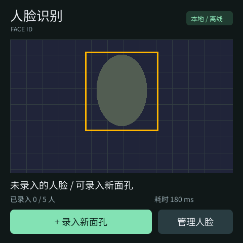

# VersatileCamera-mosaico

基于乐鑫 ESP-Mosaico 的多功能相机项目。当前提供已经在 ESP32-S31 实机验证的离线人脸识别 Idea，以及最初的 Hello World 示例。后续可以在此继续扩展功能；目前仓库尚未包含 3D 外壳模型。



人脸 Idea 支持摄像头预览、人脸框、最多五个人员编号、录入与识别、逐人删除、重启保留。推理在设备本地完成，NVS 只保存特征，不保存照片。当前没有活体检测。

## 换电脑：直接烧录

准备 Git 和 Python 3.12，将板子用 USB 数据线连接电脑，摄像头放在左侧。PowerShell 执行：

```powershell
git clone https://github.com/YantingShen-dev/VersatileCamera-mosaico.git C:\mosaico\camera
cd C:\mosaico\camera
git submodule update --init submodule/esp-mosaico-utils
python mosaico.py iris status --all --json
python mosaico.py iris list --details --project projects/face_mosaico --json
.\scripts\flash.ps1
```

烧录现成包无需安装 ESP-IDF。首次运行官方 CLI 会准备自身所需的 Python 依赖，需要联网。多块板子时使用 `-DeviceId <设备ID>`；Python 命令不叫 `python` 时可用 `-Python <python.exe路径>`。

若 PowerShell 提示禁止运行脚本，可在当前窗口执行 `Set-ExecutionPolicy -Scope Process Bypass` 后重试；该设置仅作用于当前会话。

若工具无法连接当前应用，先进入 Vibe Mode：首页关机后按住顶部 AI 键，短按 Power，出现 mosaico 后松开 AI。此处不用进入 BOOT 下载模式。CLI 会检查兼容性和更新状态，不要手动整片擦除。

安装后先测试录入与识别。要保存在板子上方便切换，返回 Vibe Mode，点 **开发 → 保存当前开发版**。以后从 **我的 Ideas → face_mosaico → 运行** 打开。同一块板子换电脑，已录入的人脸仍在板子中；换成另一块板子需要重新录入。

## 换电脑：继续开发

Windows 推荐使用上面的短英文路径；SDK 使用独立的 `C:\mosaico-env`，避免中文路径和过长路径影响工具链。Python 3.12 是本项目实测版本。

```powershell
cd C:\mosaico\camera
.\scripts\setup.ps1 -EnvironmentRoot C:\mosaico-env
.\build.ps1
```

`setup.ps1` 拉取固定版本的 BSP/工具子模块、ESP-IDF 及其子模块，安装 ESP32-S31 工具链和 Python 环境，最后运行 doctor。首次下载较大，请等待完成。已存在但版本不同的 SDK 会报错，不会自动覆盖；请改用新的 `EnvironmentRoot`。

之后每次打开新 PowerShell 会话：

```powershell
cd C:\mosaico\camera
. .\env.ps1
# 修改 projects/face_mosaico 内的源码后编译
.\build.ps1
# 打包应用与界面资源并安装当前源码版本
python mosaico.py iris system-update --project projects/face_mosaico
```

`scripts/flash.ps1` 始终安装仓库附带的已验证固件；开发新版本请使用上面的 `system-update --project`。只有纯应用代码变化、界面资源和分区表完全不变时，才可使用：

```powershell
python mosaico.py iris app-update --project projects/face_mosaico --skip-build
```

保留 SDK 提交 **`7b9cc1ac79f865983f59bb8ff3ff43eb74ff1dbe`**。上游版本和子模块提交记录在 [versions.json](versions.json)，模型和组件版本记录在应用的 `idf_component.yml`、`dependencies.lock`。不要直接换成最新 ESP-IDF。BSP 在构建时应用自己的 DVP 补丁，因此构建后的 SDK 工作区可能有预期差异。

Linux/macOS 开发也需检出相同的 ESP-IDF 提交、初始化 SDK 子模块，运行 `./install.sh esp32s31` 和 `. ./export.sh`；之后使用官方 CLI 和低噪声构建脚本。当前交付版本的完整烧录验收在 Windows 上完成，其他系统未做端到端验证。

## 代码与测试

| 位置 | 内容 |
| --- | --- |
| `projects/face_mosaico/components/app_vision` | 摄像头、PPA 图像转换、MSR/MNP 检测、MFN 特征与 NVS 存储 |
| `projects/face_mosaico/components/app_face` | 设备和模拟器共用的 GSP 界面与交互逻辑 |
| `projects/face_mosaico/main` | 启动与模块组装 |
| `projects/hello_mosaico` | 最初的 Hello World 示例 |
| `submodule/` | 固定提交的官方依赖；使用 Git 子模块获取源码 |
| `firmware/` | 已验证的 1.0.0 烧录包和 SHA-256 清单 |
| `docs/face-validation.md` | 调试修复和实机验证记录 |

编译下载组件后，可按 [模拟器说明](submodule/esp-mosaico-utils/mosaico-tools/tools/gsp-sim/README.md) 准备主机 C 编译器，运行：

```powershell
. .\env.ps1
$env:CMAKE_GENERATOR = 'Ninja'
$env:FACE_SIM_STATE = Join-Path $PWD 'evidence/face-sim-input.txt'
python mosaico.py project sim --project projects/face_mosaico --interactive
```

在另一个同样激活环境的终端安装 `projects/face_mosaico/tools/requirements-dev.txt`，再运行 `python projects/face_mosaico/tools/check_sim.py`。此脚本使用本机 `127.0.0.1:3222`，模拟录入、取消删除、删除、无脸及多人拒绝；结果保存在忽略提交的 `evidence/`。模拟器不执行真实摄像头推理。

UI 场景、字体子集和占位图片均已包含，正常编译不需要重新生成。修改中文字形时，将 `FACE_FONT_SOURCE` 指向组件下载目录中的 `lvgl__lvgl/tests/src/test_files/fonts/noto/NotoSansSC-Regular.ttf`，再运行 `tools/make_scene.py`。

2026-10-29 已验证真实预览、录入、再次识别、删除、重新录入，以及保存 Idea 后重启识别。五人满额与多人身份区分尚未做实机规模测试。设备个人特征、电脑登录信息、Gateway 状态和真实人脸照片未包含在仓库中。

项目保留原有 [MIT License](LICENSE)。上游来源与源码中的独立许可证声明见 [THIRD_PARTY.md](THIRD_PARTY.md)。
